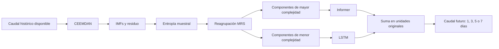

# Revisión de DMEL y preparación de su implementación

Revisión: 26 de septiembre de 2026. Fuente principal: PDF completo aportado por el usuario, 30 páginas, incluidos apéndices A–E y las 78 referencias. Las páginas citadas corresponden a la numeración impresa del PDF. Se complementó con fuentes primarias, documentación y repositorios de los autores/mantenedores. **No se ejecutó una réplica ni se entrenaron modelos.**

**Dictamen:** DMEL es implementable como arquitectura de investigación. El artículo, por sí solo, no especifica lo suficiente para reproducir exactamente sus resultados. Hay cuestiones metodológicas y discrepancias de presentación que debemos resolver o documentar antes de interpretar una implementación como validación del paper. La prioridad es establecer un pronóstico sin acceso al futuro y comparaciones con el mismo preprocesamiento.

Material complementario de esta revisión:

- [Especificación propuesta para implementar](especificacion-implementacion.md).
- [Fuentes, repositorios, datos y licencias verificadas](fuentes-implementacion.md).
- [Auditoría detallada de reproducibilidad](auditoria-reproducibilidad.md).
- [Configuración recuperada del paper, con incógnitas explícitas](dmel-paper-config.json).
- [Procedencia y límites de la investigación](revision-dmel.provenance.md).

## 1. Identificación y alcance real

Wen-chuan Wang, Miao Gu, Zong Li, Yi-yang Wang y Yan-wei Zhao: *DMEL: A novel dual-modal ensemble learning architecture for multi-step runoff prediction*. **Applied Soft Computing, 192, 114792 (2026)**. Publicado en línea el 6 de febrero de 2026. [DOI](https://doi.org/10.1016/j.asoc.2026.114792).

La tarea principal es predecir **caudal diario**, medido en m³/s, a partir de una ventana histórica de **7 días**, con salidas de **1, 3, 5 o 7 días**. No confundir la resolución diaria, la ventana de entrada y el horizonte de salida. El trabajo principal es univariado por estación; la extensión multivariada aparece después.

Aquí «dual-modal» significa dos tipos de componentes de una misma señal: variaciones complejas y componentes suaves. No significa dos sensores o dos fuentes independientes como imágenes y texto. Tampoco es aprendizaje por refuerzo: el artículo usa expresiones como “reinforcement prediction”, pero no presenta agente, recompensas o política de RL.

La contribución combina:

1. Descomponer el caudal con CEEMDAN.
2. Medir la complejidad de los componentes con entropía muestral.
3. Reagrupar componentes de complejidad semejante: MRS.
4. Asignar componentes de mayor complejidad a Informer y de menor complejidad a LSTM.
5. Sumar las predicciones de los componentes para reconstruir el caudal.

## 2. Cómo funciona, de la señal a la predicción

El diagrama representa la versión univariada de la ecuación 14 y la figura 3, pp. 5–6. La cantidad de redes independientes dentro de cada rama no queda resuelta por el dibujo.

### CEEMDAN

La señal se expresa como `q(t) = Σ IMF_i(t) + residuo(t)` (ecuación 1, p. 3). La descomposición separa escalas de variación mediante EMD y realizaciones de ruido. El artículo reporta **100 realizaciones**, ruido con desviación estándar **0.2**, y **nueve componentes** obtenidos en ambas estaciones principales (p. 7).

Nueve es un resultado observado, no un número universal de componentes que deba forzarse para cualquier serie. Tampoco queda claro si el noveno componente incorpora el residuo de la ecuación 1. La implementación debe conservarlo y comprobar reconstrucción exacta dentro de tolerancia numérica.

No se puede trasladar “0.2” a una biblioteca sin verificar su definición: ruido absoluto, factor relativo a la desviación de la señal y normalización interna no son intercambiables. PyEMD implementa además mejoras posteriores a CEEMDAN original. Véase el mapa de fuentes.

### Entropía muestral y MRS

El artículo usa `SampEn = -log(A/B)`, dimensión de incrustación **m = 2** y tolerancia **r = 0.2 × std(IMF)** (pp. 3 y 7). Una mayor entropía indica menor regularidad bajo esas convenciones. **Entropía no equivale matemáticamente a frecuencia espectral**; alta/baja frecuencia es el nombre que el paper asigna a sus grupos.

Los componentes de entropía similar se suman: `RIMF_j = Σ IMF_i`, para `i` perteneciente al grupo `G_j` (ecuación 12). Luego se vuelve a evaluar la complejidad del componente reconstruido frente a la de la señal original. La entropía de una suma no es la suma ni el promedio de las entropías individuales.

| Estación | Componentes enviados a Informer | Componente enviado a LSTM | Reducción publicada |
|---|---|---|---|
| Shuangpai | IMF1, IMF2, IMF3, IMF4, IMF5, conservados como cinco RIMFs | IMF6 + IMF7 + IMF8 + IMF9 | 9 → 6 componentes |
| Fenghuang | IMF1; IMF2; IMF3 + IMF4 + IMF5 | IMF6 + IMF7 + IMF8 + IMF9 | 9 → 4 componentes |

Fuente: tabla 3, p. 10. Las entropías originales son 0.1769 y 0.4523, respectivamente (tabla 2, p. 9). El texto reporta 0.099 para la suma baja de Shuangpai y 0.1074 para la suma baja de Fenghuang. Para la suma IMF3–5 de Fenghuang reporta 0.6825, que supera 0.4523 aunque sus componentes individuales no lo hagan.

**Información ausente:** tolerancia para considerar dos entropías “similares”, algoritmo de agrupación, orden de agrupación, tratamiento de empates y de valores infinitos. La tabla permite reconstruir esos dos casos a mano; no define un MRS automático general. El K-means de la sección 5.3 clasifica estados del caudal y no está documentado como el algoritmo de MRS.

### Redes y agregación

Informer usa atención ProbSparse, reducción de longitud mediante convolución y pooling, y un decodificador que emite varios pasos a la vez (pp. 3–4). La ecuación 4 es una presentación abreviada: no basta para implementar la selección de consultas de ProbSparse. Debemos utilizar la [implementación de los autores de Informer](https://github.com/zhouhaoyi/Informer2020).

LSTM modela las componentes suaves mediante sus estados y compuertas. El paper no define cómo convierte sus estados en una salida de H pasos, si usa una cabeza lineal o un decodificador, ni si los modelos se entrenan juntos o por componente.

La ecuación 14 especifica suma para la versión principal. En cambio, la extensión multivariada usa `cat`/concatenación (p. 25, figura 28), sin describir la reducción posterior a un caudal escalar por día. Concatenar dos salidas no equivale a sumarlas. Esa extensión necesita una definición adicional.

## 3. Especificaciones recuperadas

| Elemento | Valor publicado | Localización |
|---|---|---|
| Resolución, entrada | Diaria, 7 pasos | §3.1–3.2, p. 5 |
| Horizontes | 1, 3, 5, 7 | §3.2, p. 5 |
| División | 70 % / 15 % / 15 % | §3.1, p. 5 |
| Optimizador y pérdida | Adam, MSE | §3.2, p. 5 |
| Learning rate inicial | 0.0001 | §3.2, p. 5 |
| Épocas y batch | 100 y 32 | §3.2, p. 5 |
| Repeticiones | 10 ejecuciones independientes | §4.2, p. 8 |
| Informer | d_model 256, 8 cabezas, 2 capas encoder, 1 decoder, d_ff 1024, GELU | Tabla 1, p. 8 |
| LSTM | Hidden size 256, 2 capas | Tabla 1, p. 8 |
| Transformer | 256, 8 cabezas, encoder 2, decoder 1, d_ff 1024, GELU | Tabla 1 |
| RNN | Hidden size 256, 2 capas, tanh | Tabla 1 |
| TimesNet | 256, 2 capas, d_ff 1024, GELU, 6 kernels, top_k 5 | Tabla 1 |
| PatchTST | 256, 8 cabezas, 2 capas, d_ff 1024, GELU, patch_len 3 | Tabla 1 |
| CEEMDAN | 100 realizaciones, ruido 0.2 | §4.1, p. 7 |
| SampEn | m 2, r 0.2 × std por IMF | §4.1, p. 7 |
| Evaluación | RMSE, NSE, KGE; EP para picos | §§3.3 y 5.5 |

La figura 4 muestra bloques temporales consecutivos y la figura 10 sitúa la prueba aproximadamente en junio–diciembre de 2005. Eso apoya una división cronológica, pero no especifica índices exactos ni el orden entre división, transformación y creación de ventanas. No debemos presentarlo como un protocolo causal confirmado.

## 4. Datos y resultados que el paper reporta

| Caso | Datos | Observaciones para replicar |
|---|---|---|
| Shuangpai | Caudal diario 2002–2005, Xiangjiang, China | Datos bajo solicitud al autor; máximo publicado 6420 m³/s |
| Fenghuang | Caudal diario 2002–2005, Yuanjiang, China | Datos bajo solicitud; máximo publicado 128 m³/s |
| St. Joe | 2002–2005, caudal y 7 covariables meteorológicas | Faltan identificador de estación y procedencia exacta de covariables |
| Jemez | 1980-01-01 a 2010-12-31, USGS; área aproximada 1208 km² | El paper enlaza el inventario USGS, sin identificador inequívoco |

En el caso St. Joe aparecen `dayl`, `prcp`, `srad`, `swe`, `tmax`, `tmin`, `vp`. Debemos confirmar unidades y semántica; por ejemplo, una variable `dayl` puede ser duración astronómica del día y no horas observadas de sol. Su semejanza con productos meteorológicos conocidos no acredita el producto utilizado.

Si 2002–2005 estuviese completo habría 1461 días por estación; es un cálculo del calendario, **no un conteo comprobado de los datos**. La tabla 11 da estadísticos globales, no sustituye los archivos originales.

Los siguientes son **resultados publicados**, no resultados que hayamos reproducido:

| Caso DMEL | Horizonte | RMSE | NSE | KGE |
|---|---:|---:|---:|---:|
| Shuangpai | 1 | 126.9731 | 0.9307 | 0.9706 |
| Shuangpai | 3 | 147.4284 | 0.8926 | 0.9113 |
| Shuangpai | 5 | 164.5921 | 0.8697 | 0.8824 |
| Shuangpai | 7 | 183.8048 | 0.8255 | 0.8759 |
| Fenghuang | 1 | 1.8036 | 0.9194 | 0.9458 |
| Fenghuang | 3 | 1.9874 | 0.9001 | 0.9360 |
| Fenghuang | 5 | 2.1810 | 0.8722 | 0.8845 |
| Fenghuang | 7 | 2.3004 | 0.8517 | 0.8784 |
| St. Joe | 1 | 327.69028 | 0.8581 | 0.8857 |
| St. Joe | 7 | 382.0597 | 0.7886 | 0.8337 |
| Jemez | 1 | 21.7927 | 0.9359 | 0.9128 |
| Jemez | 7 | 25.8903 | 0.9085 | 0.8547 |

Fuentes: tablas 4 y 6, pp. 10 y 16; tabla 14, p. 25; tabla C1, p. 28. Para St. Joe y Jemez hay que confirmar las unidades antes de comparar RMSE con las estaciones chinas.

El resultado destacado es mantener NSE y KGE superiores a 0.8 a siete días en las dos estaciones principales. Eso no demuestra una extensión universal del horizonte efectivo. Tampoco significa ausencia de degradación: entre H=1 y H=7 en Shuangpai el RMSE aumenta aproximadamente **44.76 %** y NSE baja **0.1052 puntos**. La expresión “sin sacrificar precisión” debe entenderse como la interpretación de los autores, no como igualdad numérica de precisión entre horizontes.

## 5. Qué aportan las ablaciones, explicaciones y apéndices

**MRS frente a CEEMDAN sin reagrupación (pp. 11–19).** Se compara el mismo tipo de predictor con 9 componentes y con 6/4. La tabla 7 reporta una reducción de tiempo para MRS-Informer de 503.9 a 359.3 s en Shuangpai y de 525.5 a 293.2 s en Fenghuang. Es evidencia reportada a favor de reducir componentes; no explica hardware ni qué etapas entran en el tiempo.

**Asignación de modelos (pp. 16–21).** La tabla 10 compara DMEL con la asignación invertida, LSTM para alta complejidad e Informer para baja. Es una ablación relevante. La comparación debe mantener número de redes, capacidad total, política de entrenamiento y presupuesto para atribuir la diferencia a la asignación.

**Caracterización de cuencas (pp. 18–22).** K-means clasifica caudales en tres estados. Ayuda a describir los datos, pero no demuestra transferencia de un modelo entrenado en una cuenca hacia otra.

**SHAP y LIME (pp. 20–23).** El artículo atribuye a los componentes suaves una gran contribución global y a componentes complejos una contribución en picos. Estas herramientas explican asociaciones del predictor; no identifican causas hidrológicas. Faltan fondo de referencia, explainer, agrupación de retardos y procedimiento reproducible. Con suma final y ramas separadas, debe distinguirse contribución aditiva de interacción aprendida.

**Extremos (pp. 21–25).** Se selecciona el máximo diario de cada mes y se calcula `EP = 100 × abs(pred-obs)/obs`. Esa selección no prueba detección anticipada del momento de la crecida. En Shuangpai, DMEL tiene EP de **57.62 %** para el pico del 2 de julio a siete días (tabla 12): un buen promedio no garantiza precisión de todos los extremos. El conjunto presentado contiene siete máximos mensuales por estación, por lo que conviene ampliar años y medir sesgo, magnitud y tiempo del pico.

**Apéndice A (pp. 26–27).** Sensibilidad Sobol: ruido [0.1,0.5], dimensión [2,5], tolerancia [0.1,0.3], 32 conjuntos de parámetros según el texto. La salida estudiada es entropía promedio, no habilidad predictiva. El resultado no demuestra por sí mismo robustez del NSE al ruido. Falta aclarar diseño Saltelli, cantidad total de evaluaciones, redondeo de m e intervalos de confianza.

**Apéndice B (pp. 27–28).** Añade ruido y faltantes al 5 %/10 %, usa interpolación lineal y reporta H=7. No aclara por completo qué particiones reciben perturbaciones, qué observaciones se usan como objetivo ni cómo evita usar observaciones futuras en la interpolación. En Shuangpai, NSE baja de 0.8255 a 0.7783 con Noise-10 %.

**Apéndice C (p. 28).** Jemez amplía el régimen climático y la longitud del registro. Es una evaluación adicional frente a Informer, no demostración de transferencia sin reentrenamiento. El protocolo de partición y los grupos MRS específicos deben recuperarse.

**Apéndice D (pp. 28–29).** Reporta ~2.38 millones de parámetros, 0.0172 GFLOPs y ~2.5–3 ms de inferencia. Sin hardware, batch, precisión y alcance del cronometraje no se puede presupuestar nuestro entrenamiento ni afirmar latencia operativa; habría que incluir CEEMDAN y MRS al medir el proceso completo.

**Apéndice E (p. 29).** Anuncia material suplementario en el DOI. Se localizó la referencia, pero no se pudo inspeccionar el archivo: la apertura web devolvió 403 y el navegador mostró una verificación CAPTCHA.

## 6. Hallazgos que cambian la implementación

**1. Posible fuga temporal.** CEEMDAN aplicado a toda la serie puede utilizar valores posteriores al origen de predicción. Partir luego los IMFs en entrenamiento/prueba no corrige ese problema. Tampoco basta descomponer el bloque completo de prueba: el comienzo de ese bloque sigue usando su futuro. El PDF no permite comprobar qué hicieron. Esto es un riesgo no resuelto, no una acusación de fuga demostrada. La referencia 9 del propio DMEL ya estudia un [procedimiento de descomposición por pasos para evitar información futura](https://pubmed.ncbi.nlm.nih.gov/36037902/).

**2. Comparaciones ambiguas.** La sección 5.1 afirma que todos los baselines usan MRS, pero las tablas 4/6 presentan cifras distintas de los modelos MRS explícitos de la tabla 8. Por ejemplo, Shuangpai H=1: Informer RMSE=198.5082 frente a MRS-Informer=130.5517. DMEL tiene 126.9731. La ventaja cambia sustancialmente según el control. En H=7, la reducción RMSE frente a Informer de tabla 6 es ~24.02 %, y frente a MRS-Informer de tabla 8 es ~7.21 %. Son cálculos sobre tablas publicadas; su comparabilidad necesita aclaración.

**3. KGE impreso de forma problemática.** La p. 5 define sus términos mediante desviación/media del cociente observado/predicho, en vez de los cocientes habituales de desviaciones y medias. Adoptaremos explícitamente KGE original: `alpha=std(pred)/std(obs)`, `beta=mean(pred)/mean(obs)` y correlación Pearson. Esta es una convención documentada, no una confirmación del código de DMEL. [Definición desarrollada en HESS](https://hess.copernicus.org/articles/23/4323/2019/).

**4. Consistencia de evidencias.** La auditoría detalla discrepancias entre tablas, texto y figuras, incluyendo la aparente repetición de los gráficos de dispersión de dos estaciones y un chequeo de coherencia entre RMSE y NSE. Debemos obtener predicciones por fecha y por repetición para resolverlas. No atribuirlas automáticamente a mala conducta ni ignorarlas al reproducir.

**5. Ventanas cortas y modelos de secuencia larga.** Informer solo recibe siete días. Con `factor=5`, valor por defecto de su código original, `u=min(5×ceil(log(7)),7)=7`: se seleccionan todas las consultas del encoder. Esta deducción condicional limita la explicación de una ganancia por esparsidad en este caso; el paper no declara su factor. [Atención original](https://raw.githubusercontent.com/zhouhaoyi/Informer2020/main/models/attn.py). También deben revisarse los parches de PatchTST y las frecuencias de TimesNet con horizontes tan pequeños.

**6. Estadística incompleta.** Diez semillas miden variación del entrenamiento, no diez cuencas independientes. Los asteriscos Wilcoxon sin p-valores exactos, diferencias pareadas, corrección por comparaciones y predicciones no permiten reconstruir la prueba. La evaluación debe incluir magnitud del efecto y variación temporal, además de semillas.

## 7. Fuentes que sí necesitamos estudiar o reutilizar

| Prioridad | Fuente | Por qué importa |
|---|---|---|
| Esencial | [Informer: artículo y código](https://github.com/zhouhaoyi/Informer2020) | Atención, embeddings, máscaras, distilación y decoder reales |
| Esencial | [CEEMDAN de sus autores](https://perso.ens-lyon.fr/patrick.flandrin/emd.html) y [PyEMD](https://pyemd.readthedocs.io/en/latest/ceemdan.html) | Definir variante y correspondencia de parámetros |
| Esencial | [SampEn de PhysioNet](https://physionet.org/content/sampen/1.0.0/) | Contrastar el cálculo numérico de entropía |
| Esencial | [KGE: definición y comparación con NSE](https://hess.copernicus.org/articles/23/4323/2019/) | Evitar implementar una métrica diferente por error |
| Crítica | [Xu et al., 2022, referencia 9](https://pubmed.ncbi.nlm.nih.gov/36037902/) | Protocolo de descomposición utilizable en pronóstico real |
| Antecedente directo | [CEEMDAN–SE–BiLSTM, Li et al., 2023, referencia 39](https://www.nature.com/articles/s41598-023-46264-z) | Ya usa descomposición y reconstrucción por entropía para caudal |
| Antecedente directo | [CEEMDAN–Informer–LSTM, Li et al., 2025, referencia 67](https://www.sciencedirect.com/science/article/abs/pii/S1568494625005526) | Ya asigna Informer a alta frecuencia y LSTM a baja |
| Baselines | [TimesNet](https://github.com/thuml/TimesNet), [PatchTST](https://github.com/yuqinie98/PatchTST) | Contraste con implementaciones atribuibles a sus autores |

La novedad debe formularse de forma delimitada: estrategia de reagrupación y su integración/evaluación hidrológica multihorizonte. No basta afirmar que la combinación CEEMDAN + Informer + LSTM apareció por primera vez aquí. La revisión de referencias no implica haber leído íntegramente los 78 trabajos citados: se profundizó en las fuentes necesarias para el método y su evaluación.

## 8. Ruta recomendada

Primero construiremos un experimento univariado verificable: contrato de datos, particiones por fecha, métricas correctas y baselines de persistencia/LSTM. Después CEEMDAN, pruebas de reconstrucción, entropía y agrupación explícita; por último Informer y el ensamble. La versión multivariada y SHAP/LIME deben llegar después de validar la predicción causal.

Para datos originales, hace falta recuperar el suplemento y solicitar a los autores series y configuraciones. No se enviaron mensajes. Para avanzar con datos públicos, puede usarse USGS o CAMELS con estación, período y unidades documentados; sería una implementación/evaluación externa, no una réplica de las tablas principales.

Separaremos dos objetivos científicos: **reconstruir el experimento publicado** cuando se resuelvan sus incógnitas, y **evaluar una adaptación causal operativa** cuyas decisiones queden registradas. El segundo objetivo es el que puede establecer si el sistema sirve para pronosticar usando solo información disponible al emitirlo.
